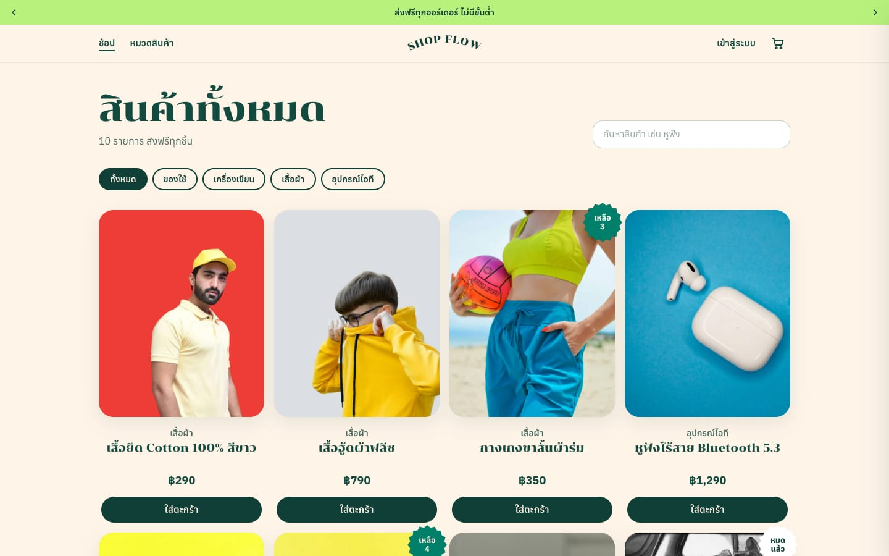
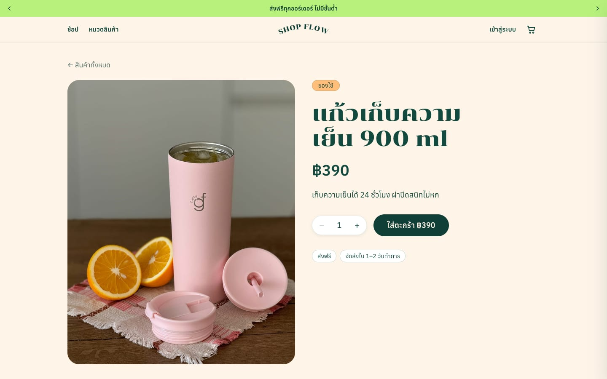
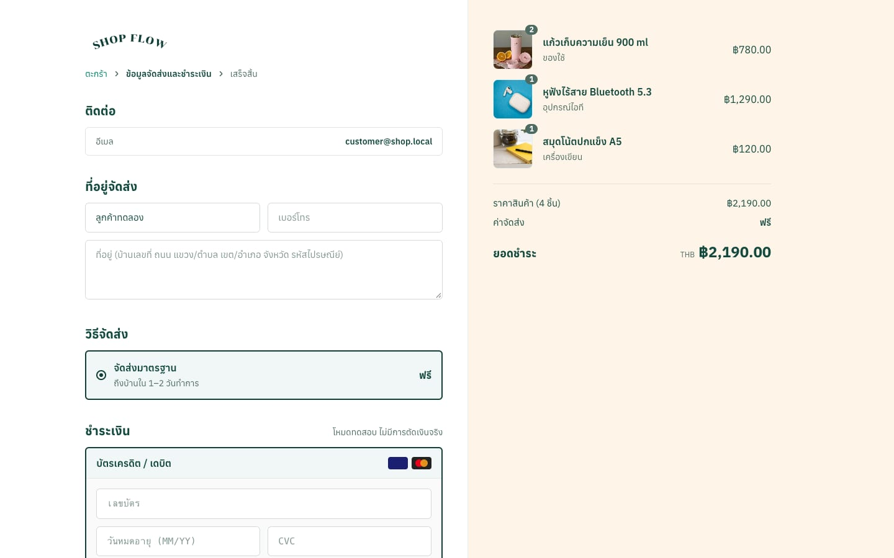
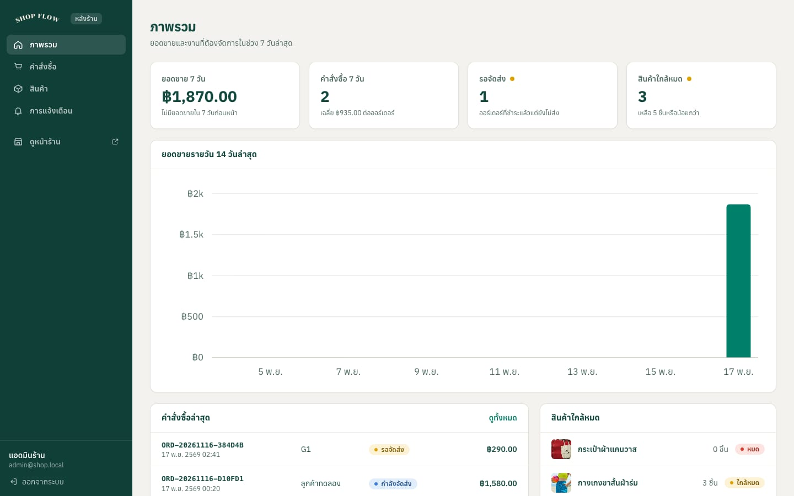
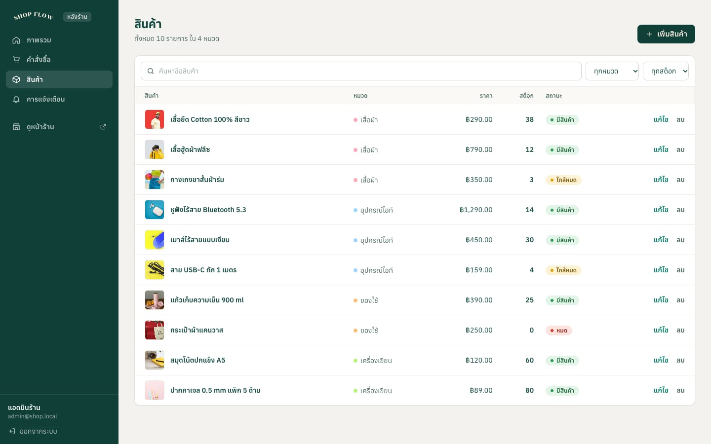
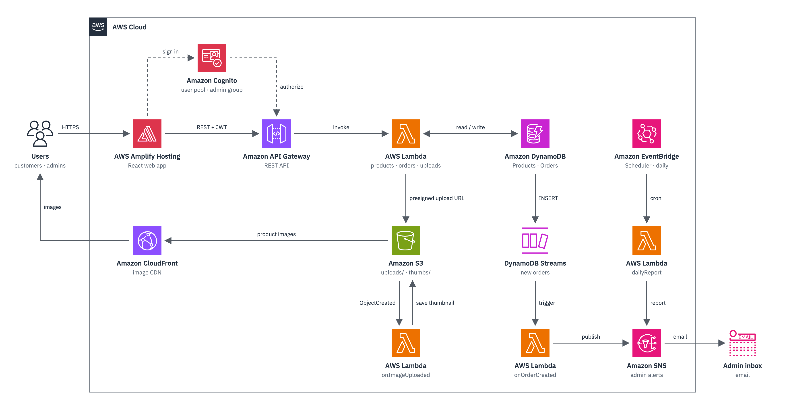

<p align="center">
  
</p>

<p align="center">
  <b>English</b> &nbsp;|&nbsp; <a href="README.th.md">ภาษาไทย</a>
</p>

<p align="center">
  
  
  
  
  
</p>

**Shop Flow** is an online general store selling clothes, IT gear, home goods and stationery. It is a project for IT332 Understanding Web Services at Bangkok University.

## Screenshots

<table>
  <tr>
    <td width="50%"></td>
    <td width="50%"></td>
  </tr>
  <tr>
    <td align="center">Home</td>
    <td align="center">All products, with category filters and search</td>
  </tr>
  <tr>
    <td></td>
    <td></td>
  </tr>
  <tr>
    <td align="center">Product page</td>
    <td align="center">Checkout</td>
  </tr>
  <tr>
    <td></td>
    <td></td>
  </tr>
  <tr>
    <td align="center">Admin: sales overview</td>
    <td align="center">Admin: products and stock</td>
  </tr>
</table>

The interface is in Thai.

## Features

**For customers**

- Sign up and log in
- Browse, search and filter products by category
- Slide-out cart drawer plus a full cart page
- Pay with test cards (no real charges)
- Order history with delivery status

**For admins (back office)**

- Overview: 7-day revenue, a 14-day daily sales chart, orders waiting to ship and low-stock items
- Add, edit and delete products, with image upload
- Manage orders: move them from waiting to ship → shipping → delivered, or cancel and restock automatically
- An inbox for notifications the system sends to admins

**Background jobs**

- Uploading a product image automatically creates a 600×750 WebP thumbnail
- A new order deducts stock, notifies admins and warns when a product runs low
- A daily report summarises sales from the last 24 hours

## Getting started

Requires [Node.js](https://nodejs.org) 20 or later.

```bash
git clone https://github.com/kongthap-phue/shop-flow.git
cd shop-flow
npm run setup   # install everything and add sample products (first run only)
npm run dev     # start the backend and the web app together
```

Open http://localhost:4300

| Part | Port |
|---|---|
| Web app (Vite) | `4300` |
| API (Express emulating API Gateway) | `4301` |

If the ports clash with something else, run `WEB_PORT=xxxx API_PORT=yyyy npm run dev`.

### Demo accounts

| Role | Email | Password |
|---|---|---|
| Admin | `admin@shop.local` | `admin1234` |
| Customer | `customer@shop.local` | `customer1234` |

The login page has buttons that fill in these accounts for you.

### Test cards

| Card number | Result |
|---|---|
| `4242 4242 4242 4242` | Payment succeeds |
| `4000 0000 0000 0002` | Card declined |

Any valid-looking expiry date and CVC work, for example `12/28` and `123`.

### Other commands

| Command | What it does |
|---|---|
| `npm run seed` | Wipe all data and reload the sample products |
| `npm run report` | Generate the daily sales report now |
| `npm run share` | Open a public https link through ngrok (keep `npm run dev` running) |

On the same Wi-Fi, others can open `http://<your IP>:4300`. On macOS, find your IP with `ipconfig getifaddr en0`.

## Architecture on AWS

<p align="center">
  
</p>

When running locally, `backend/local/server.js` stands in for every AWS service.

| Local | On AWS |
|---|---|
| Express turns requests into events | API Gateway |
| Mock login in `auth-local.js` | Cognito |
| JSON files in `backend/data` | DynamoDB |
| `backend/uploads` folder | S3 + CloudFront |
| Calls `onOrderCreated` after an order is created | DynamoDB Stream |
| Notifications written to a file | SNS |
| "Generate report" button in the back office | EventBridge (scheduled) |
| Mock card charge | Stripe / Omise test mode |

The files in `handlers/` and `events/` barely change. What gets rewritten is `lib/` and the web app's login (`frontend/src/auth.jsx`), which moves to Cognito.

## Project structure

```
shop-flow/
├── backend/
│   ├── src/                  code that goes to AWS
│   │   ├── handlers/         API: products, orders, uploads
│   │   ├── events/           onImageUploaded, onOrderCreated, dailyReport
│   │   └── lib/              db, storage, notify, payment, auth
│   └── local/                local development only
│       ├── server.js         emulates API Gateway, S3, DynamoDB Stream
│       ├── auth-local.js     mock login
│       └── seed.js           sample data
├── frontend/                 React + Vite + Tailwind
│   └── src/
│       ├── pages/            storefront, plus pages/admin for the back office
│       └── components/
└── docs/                     images used in the README
```

## API

| Method | Path | Access |
|---|---|---|
| `GET` | `/products` | Everyone |
| `GET` | `/products/{id}` | Everyone |
| `POST` | `/products` | Admin |
| `PUT` | `/products/{id}` | Admin |
| `DELETE` | `/products/{id}` | Admin |
| `POST` | `/uploads` | Admin |
| `POST` | `/orders` | Customer |
| `GET` | `/orders/me` | Customer |
| `GET` | `/orders` | Admin |
| `PATCH` | `/orders/{id}` | Admin |

## Credits

All product photos come from [Unsplash](https://unsplash.com). Photographers are listed in [CREDITS.md](CREDITS.md). The architecture diagram uses the official [AWS Architecture Icons](https://aws.amazon.com/architecture/icons/).
