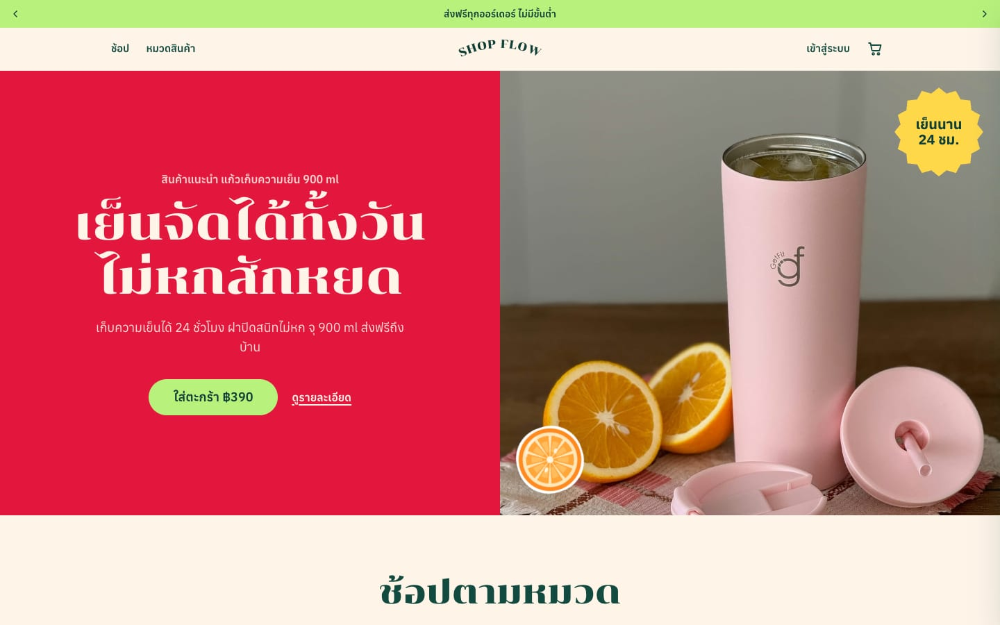
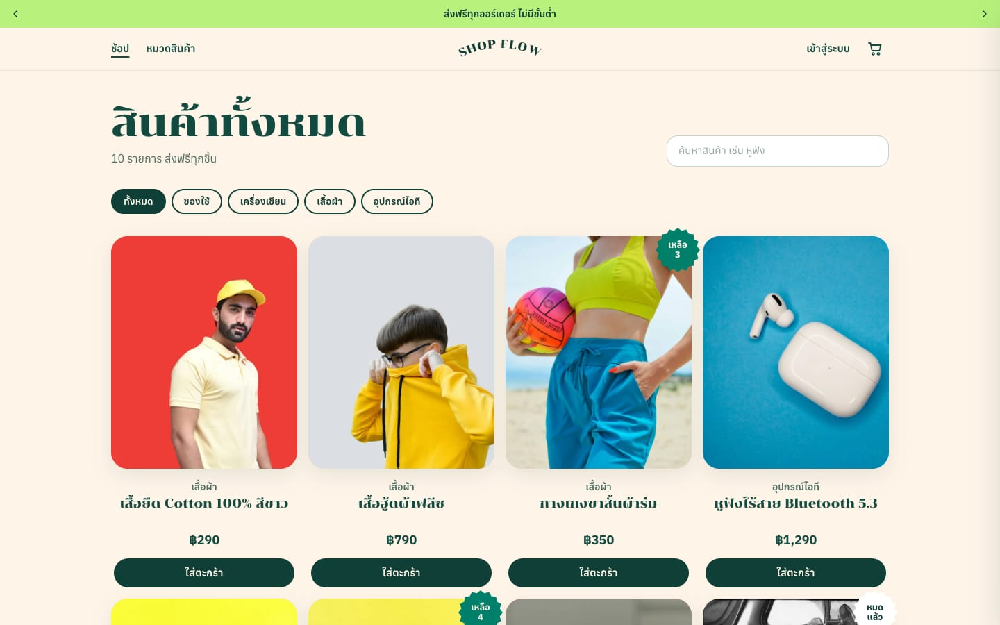
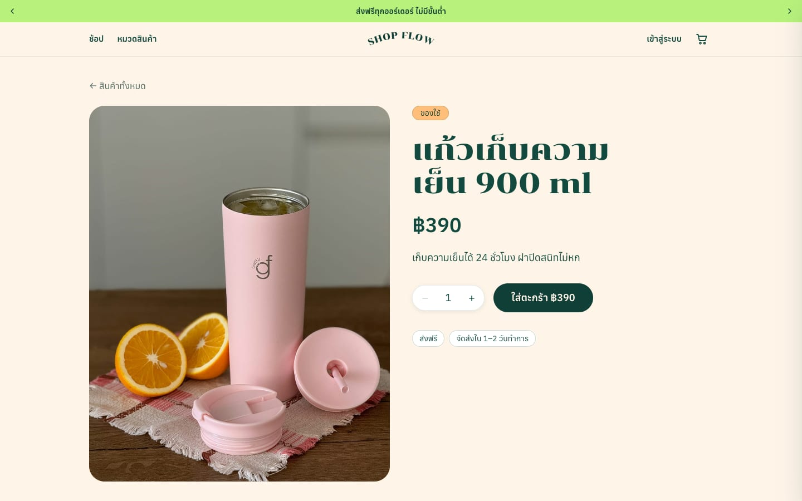
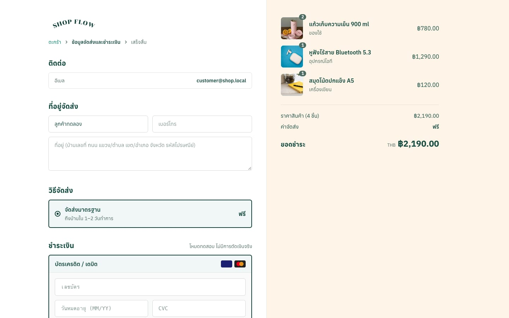
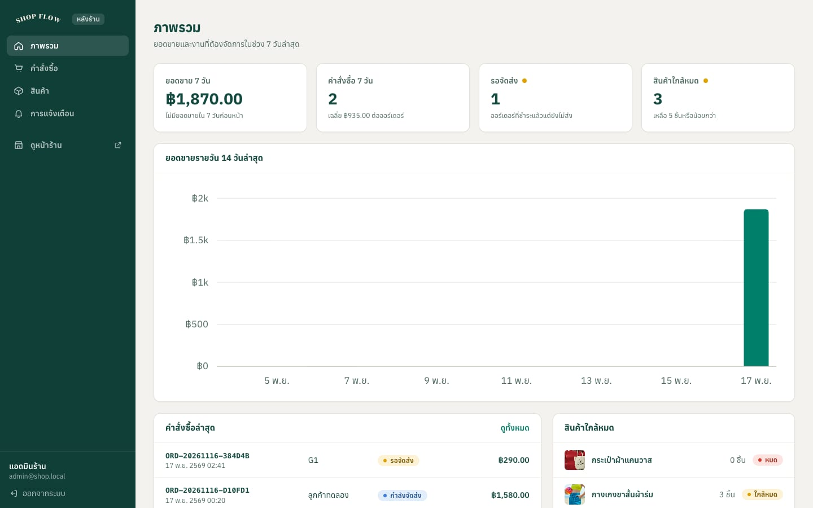
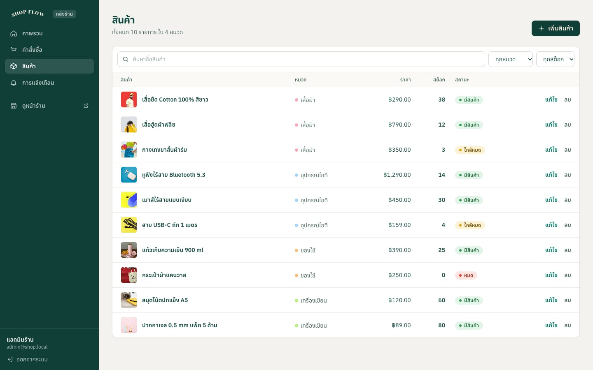
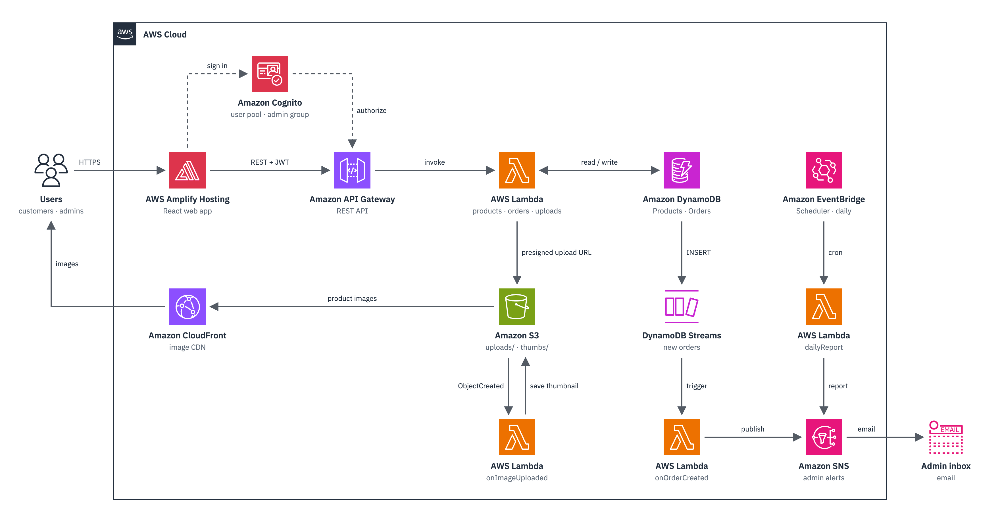

<p align="center">
  
</p>

<p align="center">
  <a href="README.md">English</a> &nbsp;|&nbsp; <b>ภาษาไทย</b>
</p>

<p align="center">
  
  
  
  
  
</p>

**Shop Flow** คือร้านค้าออนไลน์ขายของทั่วไป ทั้งเสื้อผ้า อุปกรณ์ไอที ของใช้ และเครื่องเขียน ทำเป็นโปรเจกต์วิชา IT332 Understanding Web Services มหาวิทยาลัยกรุงเทพ

## หน้าตา

<table>
  <tr>
    <td width="50%"></td>
    <td width="50%"></td>
  </tr>
  <tr>
    <td align="center">หน้าแรก</td>
    <td align="center">สินค้าทั้งหมด กรองตามหมวดและค้นหาได้</td>
  </tr>
  <tr>
    <td></td>
    <td></td>
  </tr>
  <tr>
    <td align="center">หน้าสินค้า</td>
    <td align="center">ชำระเงิน</td>
  </tr>
  <tr>
    <td></td>
    <td></td>
  </tr>
  <tr>
    <td align="center">หลังร้าน: ภาพรวมยอดขาย</td>
    <td align="center">หลังร้าน: จัดการสินค้าและสต็อก</td>
  </tr>
</table>

## ฟีเจอร์

**ฝั่งลูกค้า**

- สมัครสมาชิกและเข้าสู่ระบบ
- ดูสินค้า ค้นหา และกรองตามหมวด
- ตะกร้าแบบแถบเลื่อนจากด้านข้าง พร้อมหน้าตะกร้าเต็ม
- ชำระเงินด้วยบัตรทดสอบ (ไม่ตัดเงินจริง)
- ดูประวัติคำสั่งซื้อและสถานะการจัดส่ง

**ฝั่งแอดมิน (หลังร้าน)**

- ภาพรวมยอดขาย 7 วัน กราฟรายวัน 14 วัน ออร์เดอร์รอจัดส่ง และสินค้าใกล้หมด
- เพิ่ม แก้ไข ลบสินค้า และอัปโหลดรูป
- จัดการคำสั่งซื้อ เปลี่ยนสถานะจาก รอจัดส่ง → กำลังจัดส่ง → จัดส่งสำเร็จ หรือยกเลิกแล้วคืนสต็อกอัตโนมัติ
- กล่องแจ้งเตือนที่ระบบส่งถึงแอดมิน

**งานที่ระบบทำเองเบื้องหลัง**

- อัปโหลดรูปสินค้า แล้วระบบย่อเป็นรูปขนาด 600×750 (WebP) ให้เอง
- มีคำสั่งซื้อใหม่ ระบบตัดสต็อกและแจ้งแอดมิน พร้อมเตือนเมื่อสินค้าใกล้หมด
- สรุปยอดขาย 24 ชั่วโมงล่าสุดเป็นรายงานประจำวัน

## เริ่มใช้งาน

ต้องมี [Node.js](https://nodejs.org) 20 ขึ้นไป

```bash
git clone https://github.com/kongthap-phue/shop-flow.git
cd shop-flow
npm run setup   # ติดตั้งทุกอย่างและใส่สินค้าตัวอย่าง (รันครั้งแรกครั้งเดียว)
npm run dev     # เปิด backend และหน้าเว็บพร้อมกัน
```

เปิด http://localhost:4300

| ส่วน | พอร์ต |
|---|---|
| หน้าเว็บ (Vite) | `4300` |
| API (Express จำลอง API Gateway) | `4301` |

ถ้าพอร์ตชนกับงานอื่น เปลี่ยนได้ด้วย `WEB_PORT=xxxx API_PORT=yyyy npm run dev`

### บัญชีทดลอง

| บทบาท | อีเมล | รหัสผ่าน |
|---|---|---|
| แอดมิน | `admin@shop.local` | `admin1234` |
| ลูกค้า | `customer@shop.local` | `customer1234` |

ที่หน้าเข้าสู่ระบบมีปุ่มกรอกบัญชีทดลองให้อัตโนมัติ

### บัตรทดสอบ

| เลขบัตร | ผลลัพธ์ |
|---|---|
| `4242 4242 4242 4242` | ชำระสำเร็จ |
| `4000 0000 0000 0002` | บัตรถูกปฏิเสธ |

วันหมดอายุและ CVC ใส่อะไรก็ได้ที่ถูกรูปแบบ เช่น `12/28` และ `123`

### คำสั่งอื่น

| คำสั่ง | ทำอะไร |
|---|---|
| `npm run seed` | ล้างข้อมูลทั้งหมดแล้วใส่สินค้าตัวอย่างใหม่ |
| `npm run report` | สร้างรายงานยอดขายประจำวันทันที |
| `npm run share` | เปิดลิงก์ https ผ่าน ngrok ให้คนอื่นเข้าดูได้ (ต้องเปิด `npm run dev` ไว้ก่อน) |

ถ้าอยู่ Wi-Fi เดียวกัน เข้าผ่าน `http://<IP ของเครื่อง>:4300` ได้เลย ดู IP บน macOS ด้วย `ipconfig getifaddr en0`

## ติดตั้งบน AWS

ร้านเปิดใช้งานจริงบน AWS แล้วที่ **https://main.d2yz42dazxw1qn.amplifyapp.com**

คู่มือติดตั้งทีละขั้นพร้อมภาพหน้าจอทุกบริการอยู่ที่ **[docs/AWS-DEPLOYMENT.md](docs/AWS-DEPLOYMENT.md)** (ภาษาอังกฤษ) เขียนจากการติดตั้งจริงบนบัญชี AWS Academy Learner Lab (`us-east-1`, `LabRole`) กลุ่มอื่นทำตามแล้วจะได้ผลลัพธ์เดียวกัน

ไฟล์ที่ต้องอัปโหลดทั้ง 3 ไฟล์สร้างได้ด้วยสคริปต์ในโฟลเดอร์ `aws/`

```bash
./aws/build-lambda.sh
node aws/make-openapi.mjs us-east-1 <account-id> <user-pool-id> aws-build/shopflow-api.openapi.json
./aws/build-web.sh <invoke-url> <user-pool-id> <app-client-id>
```

## สถาปัตยกรรมบน AWS

<p align="center">
  
</p>

ตอนรันในเครื่อง `backend/local/server.js` ทำหน้าที่แทนบริการ AWS ทั้งหมด

| ในเครื่อง | บน AWS |
|---|---|
| Express แปลง request เป็น event | API Gateway |
| ล็อกอินจำลอง `auth-local.js` | Cognito |
| ไฟล์ JSON ใน `backend/data` | DynamoDB |
| โฟลเดอร์ `backend/uploads` | S3 (บัญชีปกติใช้ CloudFront ส่วน Learner Lab ใช้ลิงก์ S3 แบบมีลายเซ็น) |
| เรียก `onOrderCreated` หลังสร้างออร์เดอร์ | DynamoDB Stream |
| บันทึกแจ้งเตือนลงไฟล์ | SNS |
| ปุ่มสร้างรายงานในหลังร้าน | EventBridge (ตั้งเวลา) |
| จำลองการตัดบัตร | Stripe / Omise test mode |

โค้ดชุดเดียวกันรันได้ทั้งในเครื่องและบน AWS ไฟล์ใน `backend/src/lib` จะเลือกใช้เวอร์ชัน AWS (`db-aws.js`, `storage-aws.js`, `notify-aws.js`) เองเมื่อมี environment variable ของ AWS ส่วนหน้าเว็บจะใช้ Cognito เมื่อ build พร้อม `VITE_COGNITO_CLIENT_ID`

## โครงสร้างโปรเจกต์

```
shop-flow/
├── backend/
│   ├── src/                  โค้ดที่จะขึ้น AWS
│   │   ├── handlers/         API: products, orders, uploads
│   │   ├── events/           onImageUploaded, onOrderCreated, dailyReport
│   │   └── lib/              db, storage, notify, payment, auth
│   └── local/                ใช้เฉพาะตอนรันในเครื่อง
│       ├── server.js         จำลอง API Gateway, S3, DynamoDB Stream
│       ├── auth-local.js     ล็อกอินจำลอง
│       └── seed.js           ข้อมูลตัวอย่าง
├── frontend/                 React + Vite + Tailwind
│   └── src/
│       ├── pages/            หน้าร้าน และ pages/admin สำหรับหลังร้าน
│       └── components/
├── aws/                      สคริปต์ build และไฟล์นิยาม API สำหรับ AWS
└── docs/                     คู่มือ AWS และรูปที่ใช้ใน README
```

## API

| Method | Path | สิทธิ์ |
|---|---|---|
| `GET` | `/products` | ทุกคน |
| `GET` | `/products/{id}` | ทุกคน |
| `POST` | `/products` | แอดมิน |
| `PUT` | `/products/{id}` | แอดมิน |
| `DELETE` | `/products/{id}` | แอดมิน |
| `POST` | `/uploads` | แอดมิน |
| `POST` | `/orders` | ลูกค้า |
| `GET` | `/orders/me` | ลูกค้า |
| `GET` | `/orders` | แอดมิน |
| `PATCH` | `/orders/{id}` | แอดมิน |

## เครดิต

รูปสินค้าทั้งหมดมาจาก [Unsplash](https://unsplash.com) ดูรายชื่อช่างภาพได้ที่ [CREDITS.md](CREDITS.md) ส่วนแผนภาพสถาปัตยกรรมใช้ไอคอนทางการจาก [AWS Architecture Icons](https://aws.amazon.com/architecture/icons/)
