# คู่มือติดตั้ง Shop Flow บน AWS

<p align="center">
  <a href="AWS-DEPLOYMENT.md">English</a> &nbsp;|&nbsp; <b>ภาษาไทย</b>
</p>

คู่มือนี้คือขั้นตอนจริงทั้งหมดที่เราใช้ติดตั้ง Shop Flow บน AWS มีภาพหน้าจอประกอบทุกหน้าที่สำคัญ ทำตามจากบนลงล่างแล้วจะได้ร้านที่ใช้งานได้เหมือนกัน

**ผลลัพธ์ที่ใช้งานได้จริง:** https://main.d2yz42dazxw1qn.amplifyapp.com

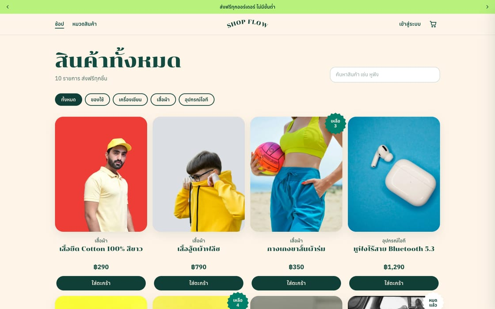

## สารบัญ

1. [สิ่งที่จะได้](#สิ่งที่จะได้)
2. [ก่อนเริ่ม](#ก่อนเริ่ม)
3. [ขั้นที่ 0 · สร้างไฟล์สำหรับอัปโหลดในเครื่อง](#ขั้นที่-0--สร้างไฟล์สำหรับอัปโหลดในเครื่อง)
4. [ขั้นที่ 1 · ตาราง DynamoDB](#ขั้นที่-1--ตาราง-dynamodb)
5. [ขั้นที่ 2 · S3 bucket เก็บรูปสินค้า](#ขั้นที่-2--s3-bucket-เก็บรูปสินค้า)
6. [ขั้นที่ 3 · SNS topic แจ้งเตือนแอดมิน](#ขั้นที่-3--sns-topic-แจ้งเตือนแอดมิน)
7. [ขั้นที่ 4 · Cognito user pool](#ขั้นที่-4--cognito-user-pool)
8. [ขั้นที่ 5 · ฟังก์ชัน Lambda](#ขั้นที่-5--ฟังก์ชัน-lambda)
9. [ขั้นที่ 6 · ผูก trigger](#ขั้นที่-6--ผูก-trigger)
10. [ขั้นที่ 7 · API Gateway](#ขั้นที่-7--api-gateway)
11. [ขั้นที่ 8 · ตั้งเวลารายงานประจำวัน](#ขั้นที่-8--ตั้งเวลารายงานประจำวัน)
12. [ขั้นที่ 9 · หน้าเว็บบน Amplify Hosting](#ขั้นที่-9--หน้าเว็บบน-amplify-hosting)
13. [ขั้นที่ 10 · ทดสอบทั้งระบบ](#ขั้นที่-10--ทดสอบทั้งระบบ)
14. [อัปเดตแอปภายหลัง](#อัปเดตแอปภายหลัง)
15. [ปัญหาที่เจอบ่อย](#ปัญหาที่เจอบ่อย)
16. [ลบทิ้งเมื่อเลิกใช้](#ลบทิ้งเมื่อเลิกใช้)

## สิ่งที่จะได้

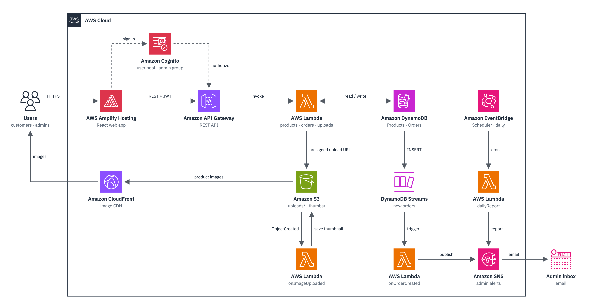

| บริการ | ชื่อที่เราใช้ | หน้าที่ |
|---|---|---|
| ตาราง DynamoDB | `shopflow-products` | เก็บสินค้า |
| ตาราง DynamoDB | `shopflow-orders` (มี index `byUser` และเปิด stream) | เก็บคำสั่งซื้อ |
| S3 bucket | `shopflow-images-<account id>` | รูปต้นฉบับใน `uploads/` และรูปย่อใน `thumbs/` |
| SNS topic | `shopflow-admin-alerts` | ส่งอีเมลถึงแอดมินร้าน |
| Cognito user pool | app client `shopflow-web` และกลุ่ม `admin` | สมัครสมาชิก เข้าสู่ระบบ และสิทธิ์แอดมิน |
| Lambda | `shopflow-api` | รับทุกเส้นทางของ REST API |
| Lambda | `shopflow-on-image-uploaded` | ย่อรูปเป็น WebP ขนาด 600×750 (trigger จาก S3) |
| Lambda | `shopflow-on-order-created` | ตัดสต็อกและส่งอีเมลแจ้งแอดมิน (trigger จาก DynamoDB Stream) |
| Lambda | `shopflow-daily-report` | รายงานยอดขายประจำวัน (EventBridge Scheduler) |
| Lambda | `shopflow-presignup` | ยืนยันผู้สมัครใหม่อัตโนมัติ (trigger จาก Cognito) |
| Lambda | `shopflow-seed` | ใส่สินค้าตัวอย่าง 10 รายการ (รันครั้งเดียว) |
| API Gateway | `shopflow-api` stage `prod` | API สาธารณะแบบ HTTPS |
| EventBridge Scheduler | `shopflow-daily-report` | สั่งรันรายงานทุกวันเวลา 08:00 ตามเวลากรุงเทพฯ |
| Amplify Hosting | แอป `shopflow` branch `main` | หน้าเว็บ React |

## ก่อนเริ่ม

- ใช้ **AWS Academy Learner Lab** (คู่มือนี้ทำบน Learner Lab) กด Start Lab แล้วเปิด AWS Console จากหน้าแล็บ ถ้าใช้บัญชี AWS ปกติก็ทำได้ ดูหมายเหตุที่เขียนว่า *บัญชี AWS ปกติ*
- ใช้ Region **US East (N. Virginia) `us-east-1`** กับทุกบริการ ดูเมนู Region มุมขวาบนก่อนสร้างอะไรทุกครั้ง
- ในเครื่องต้องมี Node.js 20 ขึ้นไป, `git` และ `zip` ถ้าใช้ Windows ให้รันคำสั่งใน **Git Bash** หรือ **WSL**
- โหลดโปรเจกต์นี้และรัน `npm run setup` ให้เรียบร้อย

```bash
git clone https://github.com/kongthap-phue/shop-flow.git
cd shop-flow
npm run setup
```

### ข้อจำกัดของ Learner Lab และวิธีที่เราใช้แทน

| ข้อจำกัดใน Learner Lab | วิธีที่เราใช้ |
|---|---|
| สร้าง IAM role เองไม่ได้ | ทุก Lambda และ schedule ใช้ role ที่มีอยู่แล้วชื่อ **`LabRole`** |
| สร้าง CloudFront distribution ไม่ได้ (โดนปฏิเสธ `cloudfront:CreateDistribution`) | ให้ bucket เป็นส่วนตัวต่อไป แล้วให้ API ส่ง **ลิงก์ S3 แบบมีลายเซ็น (presigned URL)** ของรูปกลับไปแทน ไม่ต้องตั้งค่าอะไรเพิ่ม โค้ดทำให้เองเมื่อไม่มี `ASSET_BASE_URL` |
| ไม่ต้องปิด *Block public access* ของ S3 | ปล่อย **เปิด** ไว้ตามค่าเริ่มต้น |

### จดค่าเหล่านี้ไว้ระหว่างทำ

| ค่า | ได้จาก | ใช้ที่ |
|---|---|---|
| Account ID (ตัวเลข 12 หลัก) | มุมขวาบนของ Console | ชื่อ bucket และ ARN ต่างๆ |
| SNS topic ARN | ขั้นที่ 3 | environment variable ของ Lambda |
| User pool ID | ขั้นที่ 4 | ตอน build หน้าเว็บ |
| App client ID | ขั้นที่ 4 | ตอน build หน้าเว็บ |
| Invoke URL ของ API | ขั้นที่ 7 | ตอน build หน้าเว็บ |
| โดเมนของ Amplify | ขั้นที่ 9 | เปิดเข้าร้าน |

## ขั้นที่ 0 · สร้างไฟล์สำหรับอัปโหลดในเครื่อง

ในโฟลเดอร์ [`aws/`](../aws) มีสคริปต์ 2 ตัวสำหรับสร้างไฟล์ที่ต้องอัปโหลด

```bash
./aws/build-lambda.sh
```

คำสั่งนี้สร้างไฟล์ `aws-build/shopflow-backend.zip` (ราว 8 MB) ข้างในมีโค้ด backend จาก `backend/src`, รูปสินค้าตัวอย่าง และ `sharp` (ตัวย่อรูป) รุ่น **Linux** ที่ Lambda ต้องใช้ ส่วน AWS SDK ไม่ได้ใส่ไปด้วย เพราะ Lambda รุ่น Node.js มีให้อยู่แล้ว

ไฟล์ของหน้าเว็บจะสร้างทีหลังในขั้นที่ 9 เพราะต้องใช้ค่าจากขั้นที่ 4 และ 7

> **โค้ดสลับไปใช้ AWS ได้อย่างไร** ไฟล์ `backend/src/lib/db.js`, `storage.js` และ `notify.js` จะเลือกใช้เวอร์ชัน AWS (`*-aws.js`) เองเมื่อมี environment variable `PRODUCTS_TABLE`, `BUCKET` และ `TOPIC_ARN` ถ้าไม่มีจะใช้เวอร์ชันในเครื่อง ส่วนหน้าเว็บจะใช้ Cognito เมื่อ build พร้อม `VITE_COGNITO_CLIENT_ID` ดังนั้น `npm run dev` ในเครื่องยังใช้ได้เหมือนเดิมทุกอย่าง

## ขั้นที่ 1 · ตาราง DynamoDB

1. เปิด **DynamoDB → Tables → Create table**
2. Table name `shopflow-products`, Partition key `productId` (String) เลือก **Default settings** แล้วกด **Create table**

   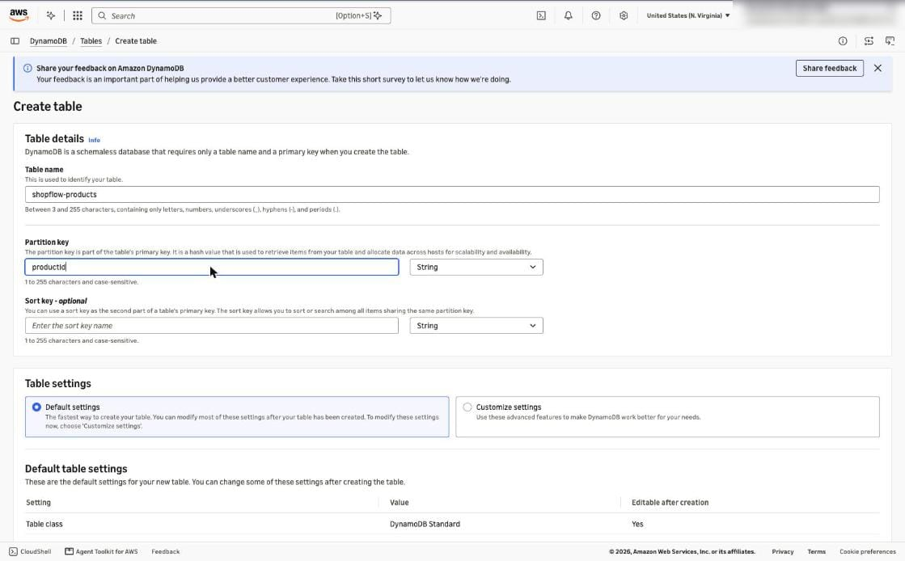

3. สร้างตารางที่สองแบบเดียวกัน ชื่อ `shopflow-orders` partition key `orderId` (String)
4. รอจนทั้งสองตารางขึ้น **Active** เปิด `shopflow-orders` → แท็บ **Indexes** → **Create index**
   - Partition key `userId` (String)
   - Sort key `createdAt` (String)
   - Index name `byUser`

   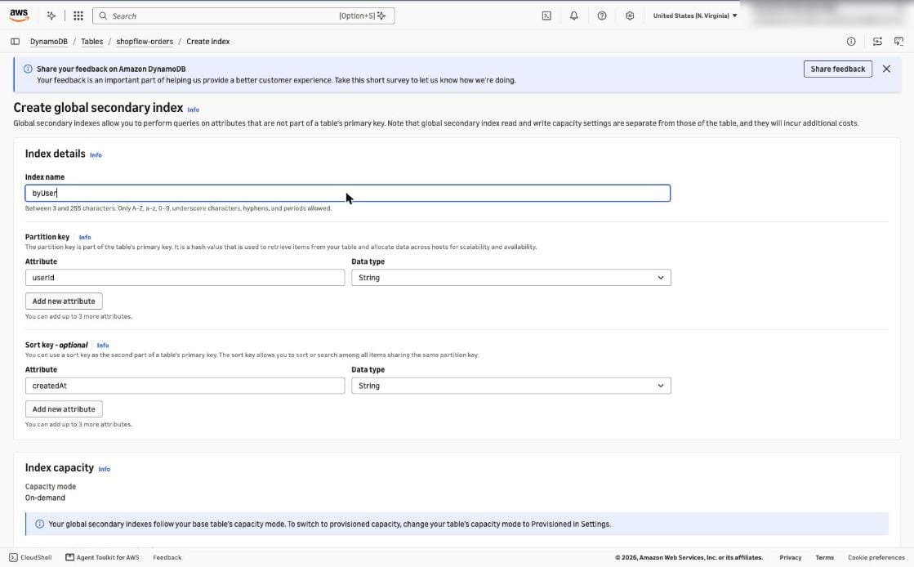

5. ยังอยู่ที่ `shopflow-orders` ไปแท็บ **Exports and streams** → **DynamoDB stream details** → **Turn on** เลือก **New image** แล้วกด **Turn on stream** (ถ้าปุ่มเป็นสีเทา ให้รอ index สร้างเสร็จแล้วรีเฟรช)

   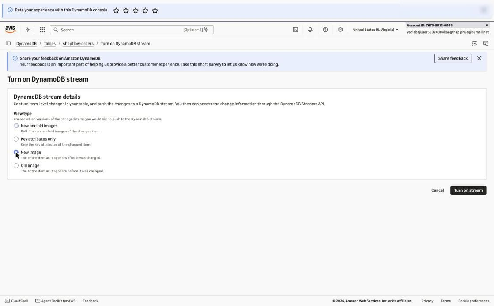

## ขั้นที่ 2 · S3 bucket เก็บรูปสินค้า

1. เปิด **S3 → Create bucket**
2. Bucket name `shopflow-images-<account id ของเรา>` เช่น `shopflow-images-767398126995` เปิด **Block all public access** ไว้ตามเดิม แล้วกด **Create bucket**

   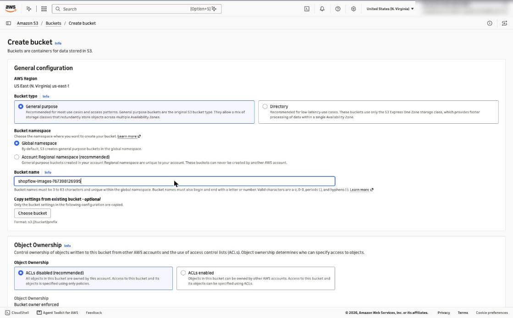

3. เปิด bucket → **Permissions** → **Cross-origin resource sharing (CORS)** → **Edit** วางค่านี้แล้วกด **Save changes** เพื่อให้เบราว์เซอร์อัปรูปตรงเข้า S3 ได้

   ```json
   [{"AllowedOrigins": ["*"], "AllowedMethods": ["PUT"], "AllowedHeaders": ["*"], "MaxAgeSeconds": 3000}]
   ```

   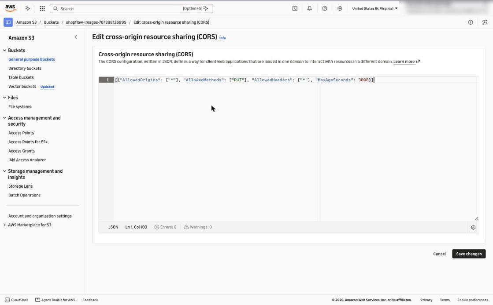

### เรื่อง CloudFront

ในแผนภาพสถาปัตยกรรมมี CloudFront อยู่หน้า S3 แต่ใน Learner Lab สร้าง distribution ไม่ได้

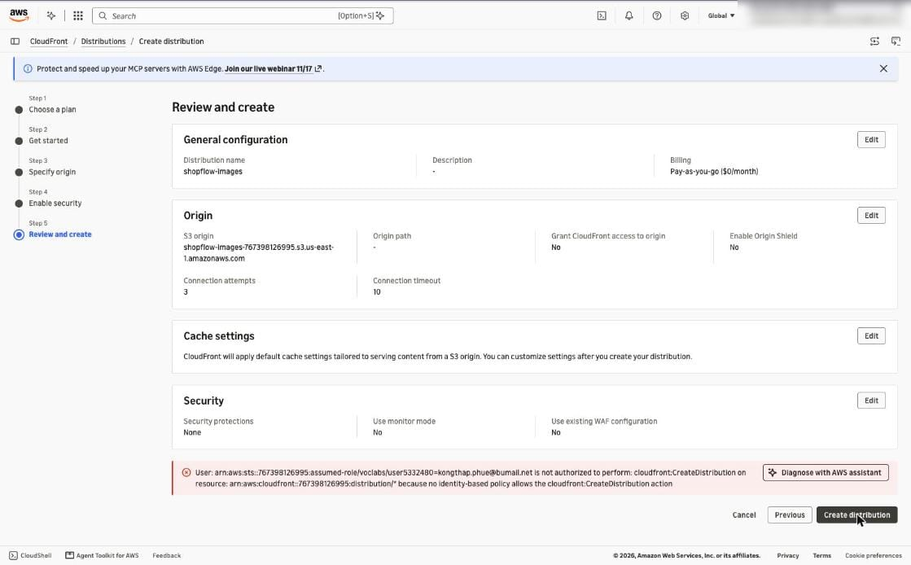

ถ้าใช้ Learner Lab ให้ข้าม CloudFront ไปเลย API จะสร้างลิงก์ S3 ชั่วคราว (ใช้ได้ 12 ชั่วโมง) ให้ทุกรูปที่ส่งกลับไป bucket จึงยังเป็นส่วนตัวอยู่

> *บัญชี AWS ปกติ:* สร้าง distribution โดยเลือก bucket นี้เป็น origin และติ๊ก **Allow private S3 bucket access to CloudFront** จากนั้นเพิ่ม environment variable `ASSET_BASE_URL=https://<โดเมนของ distribution>` ให้ Lambda โค้ดจะส่งลิงก์ CloudFront แทนลิงก์ S3 แบบมีลายเซ็น
>
> 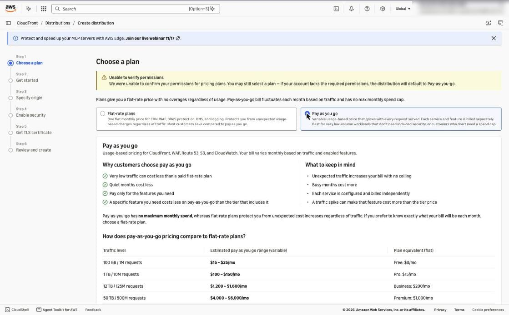
> 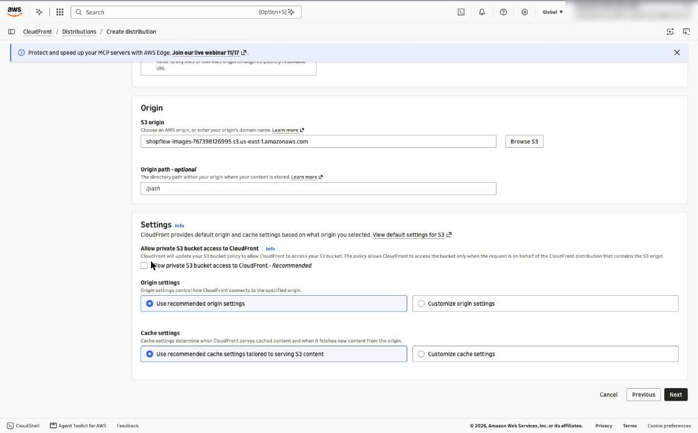

## ขั้นที่ 3 · SNS topic แจ้งเตือนแอดมิน

1. เปิด **Simple Notification Service → Topics → Create topic**
2. Type **Standard**, ชื่อ `shopflow-admin-alerts` แล้วกด **Create topic** จากนั้นคัดลอก **ARN** ของ topic เก็บไว้

   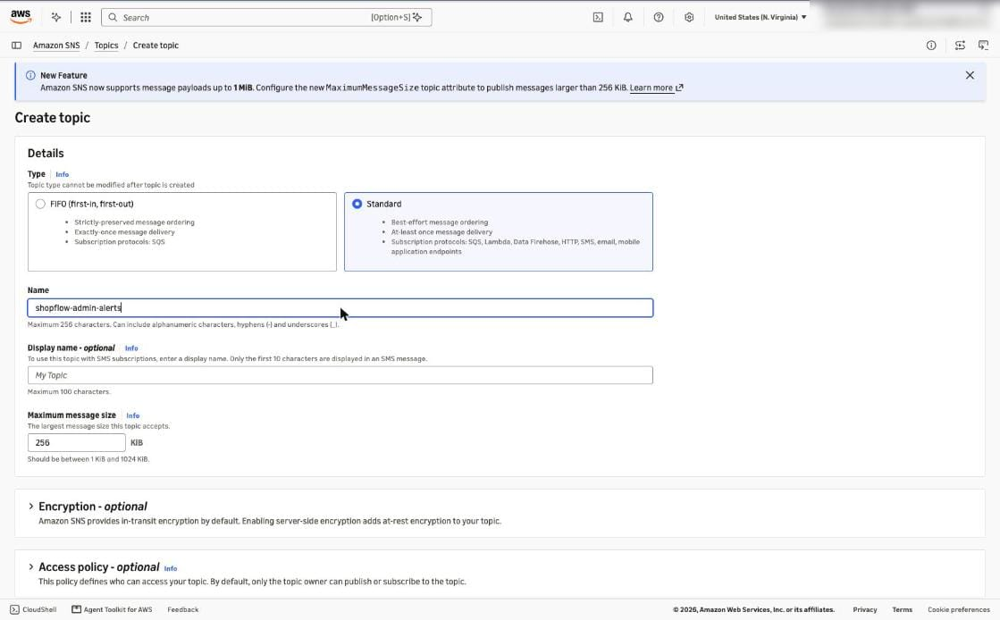

3. ในหน้า topic กด **Create subscription** เลือก protocol **Email**, endpoint ใส่อีเมลแอดมิน แล้วกด **Create subscription**

   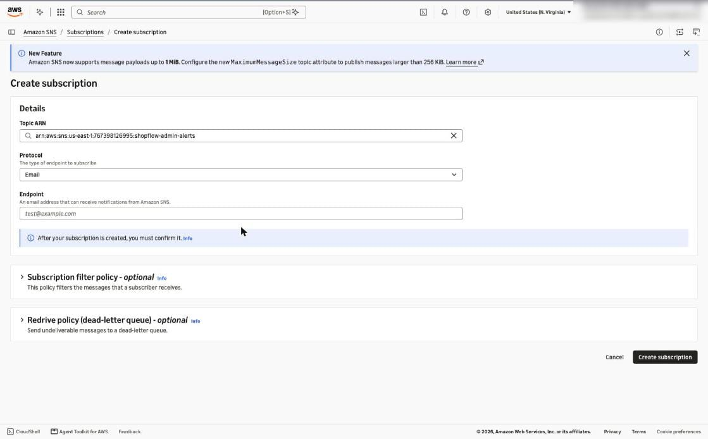

4. เปิดอีเมลจาก *AWS Notifications* แล้วกด **Confirm subscription** ถ้าไม่เจอให้ดูในถังขยะ ถ้ายังไม่กดยืนยันจะไม่มีอีเมลแจ้งเตือนส่งมาเลย

## ขั้นที่ 4 · Cognito user pool

1. เปิด **Cognito → Create user pool** แล้วกรอก
   - Application type **Single-page application (SPA)**
   - Name `shopflow-web`
   - Sign-in identifier ติ๊ก **Email** อย่างเดียว
   - ติ๊ก **Enable self-registration**
   - Required attributes เลือก **email** และ **name**
   - Return URL เว้นว่างไว้ แล้วกด **Create user directory**

   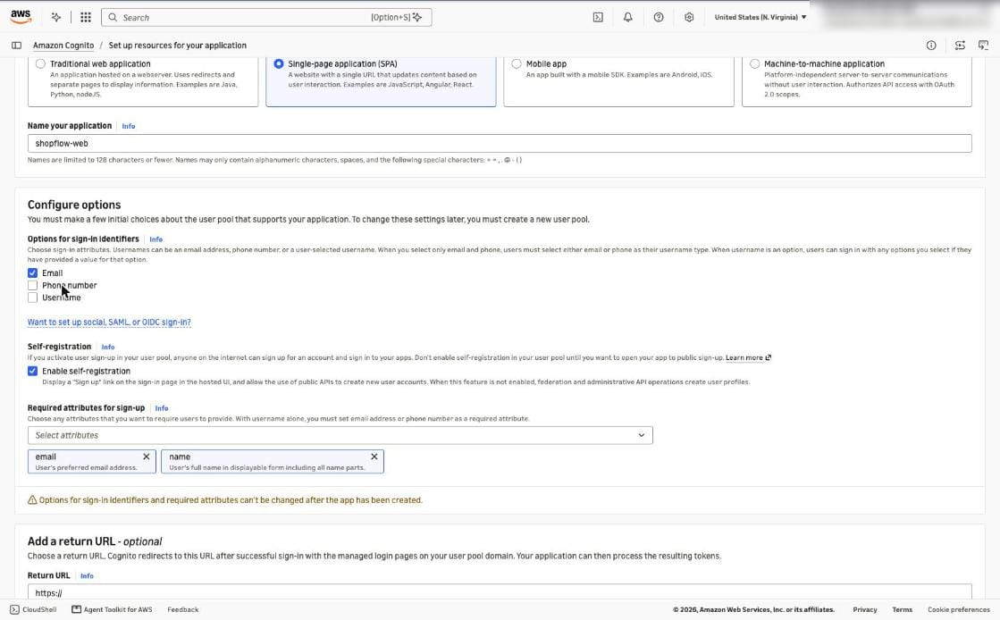

2. ไปที่ **User pools** แล้วคัดลอก **User pool ID** (หน้าตาแบบ `us-east-1_0kEUwS3RQ`) จากนั้นเปิด pool → **App clients** แล้วคัดลอก **Client ID**

   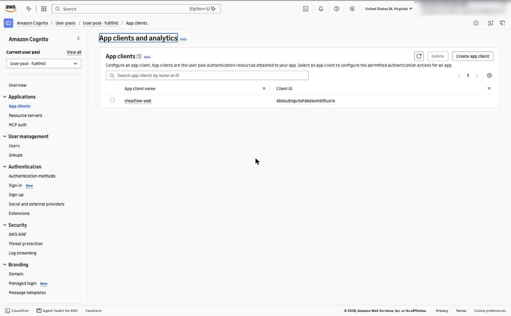

3. **Authentication methods → Password policy → Edit** เลือก **Custom** ตั้งความยาวขั้นต่ำ **8** แล้วเอาติ๊กข้อบังคับตัวอักษรทั้ง 4 ข้อออก กด **Save changes** เพราะหน้าสมัครของเราตรวจแค่ความยาว

   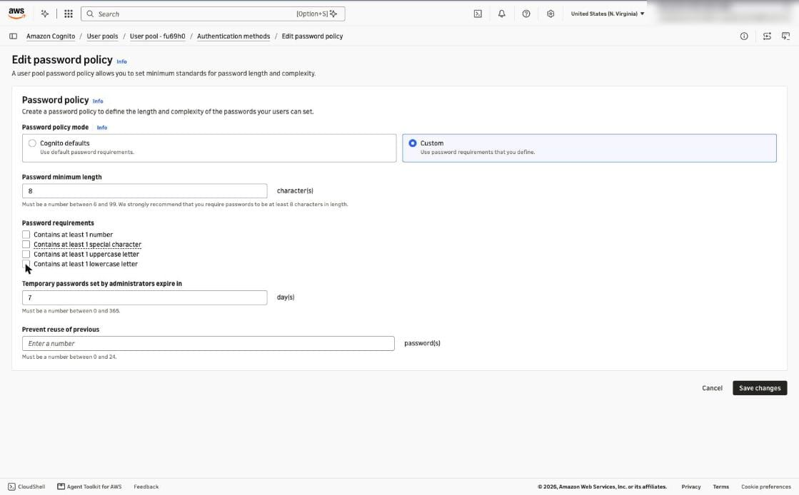

4. **Groups → Create group** ตั้งชื่อ `admin` แล้วกด **Create group** ผู้ใช้ในกลุ่มนี้จะเข้าหลังร้านได้

   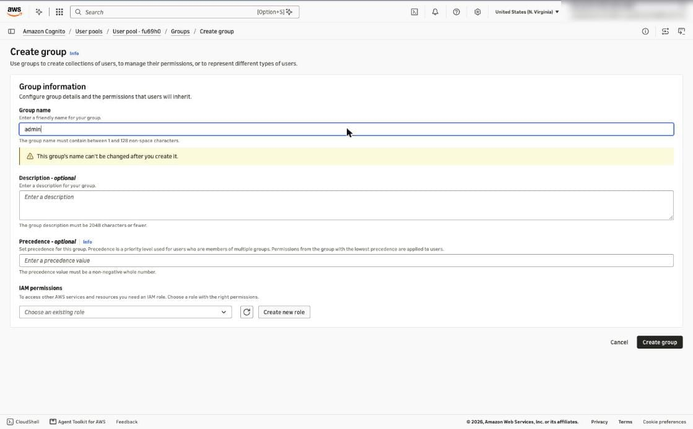

trigger Pre sign-up จะผูกในขั้นที่ 6 หลังจากสร้าง Lambda ของมันแล้ว

## ขั้นที่ 5 · ฟังก์ชัน Lambda

### 5.1 `shopflow-presignup` (พิมพ์โค้ดใน Console)

1. **Lambda → Create function → Author from scratch** ตั้งชื่อ `shopflow-presignup`, runtime **Node.js** (เลือกรุ่นใหม่สุดที่มี เราใช้ 26.x), architecture **x86_64**
2. เปิด **Additional settings** เปิด **Custom execution role** เลือก **`LabRole`** กด **Save** แล้วกด **Create function**

   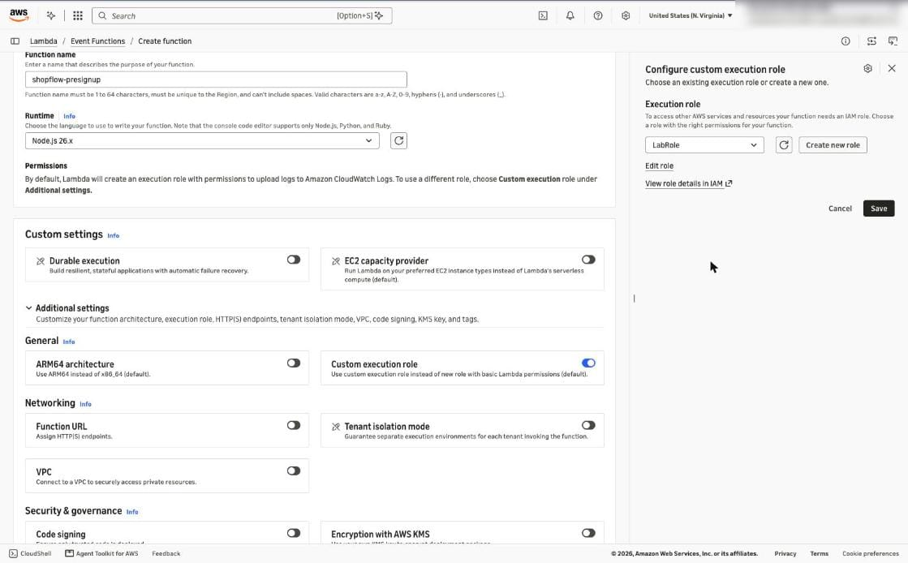

3. แทนโค้ดใน `index.mjs` ด้วยโค้ดนี้ แล้วกด **Deploy**

   ```javascript
   export const handler = async (event) => {
     event.response.autoConfirmUser = true;
     event.response.autoVerifyEmail = true;
     return event;
   };
   ```

   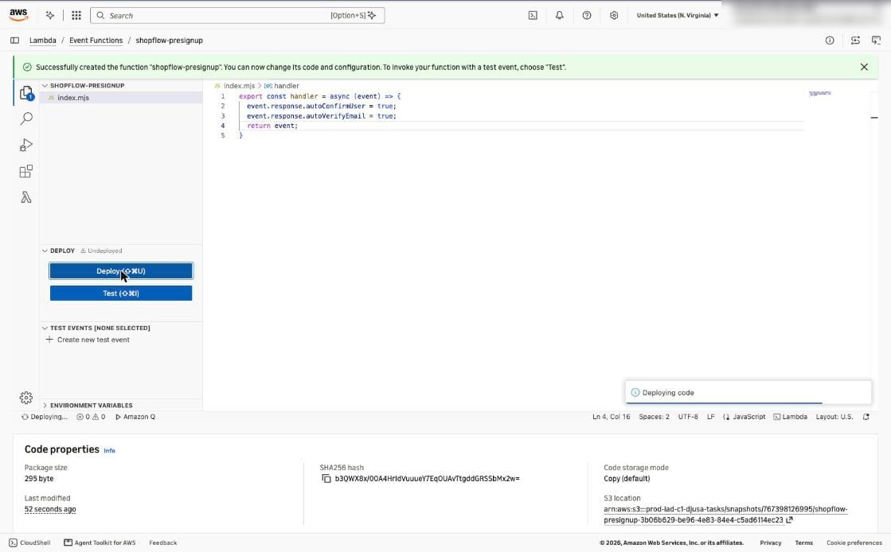

### 5.2 `shopflow-api` (อัปโหลดโค้ดจาก zip)

1. สร้างฟังก์ชันชื่อ `shopflow-api` แบบเดียวกับข้อ 5.1 (runtime เดียวกัน, x86_64, `LabRole`)
2. **Code → Update → Update from a .zip file** เลือก `aws-build/shopflow-backend.zip` แล้วกด **Update**

   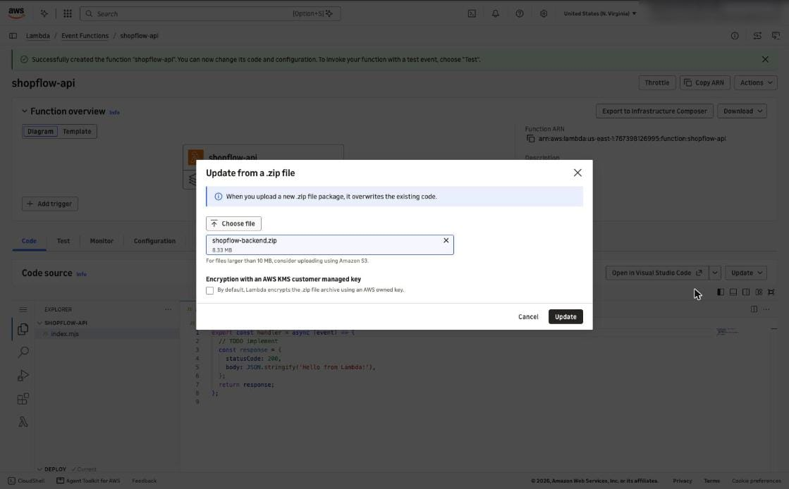

3. **Code → Runtime settings → Edit** ตั้ง Handler เป็น `src/api.handler` แล้วกด **Save** จากนั้นเช็กอีกรอบว่า handler เปลี่ยนจริง เพราะถ้ากดตอนที่ zip ยังอัปโหลดไม่เสร็จ ค่าอาจไม่ถูกบันทึก

   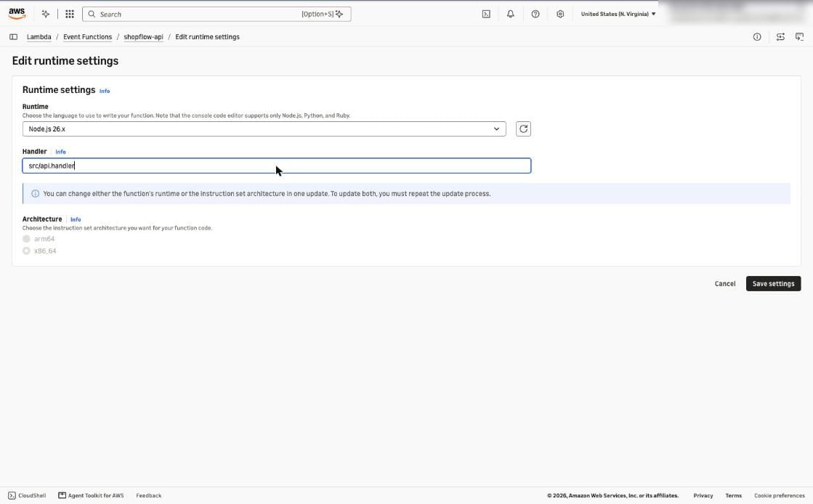

4. **Configuration → General configuration → Edit** ตั้ง Memory `512` MB, Timeout `15` วินาที แล้วกด **Save**

   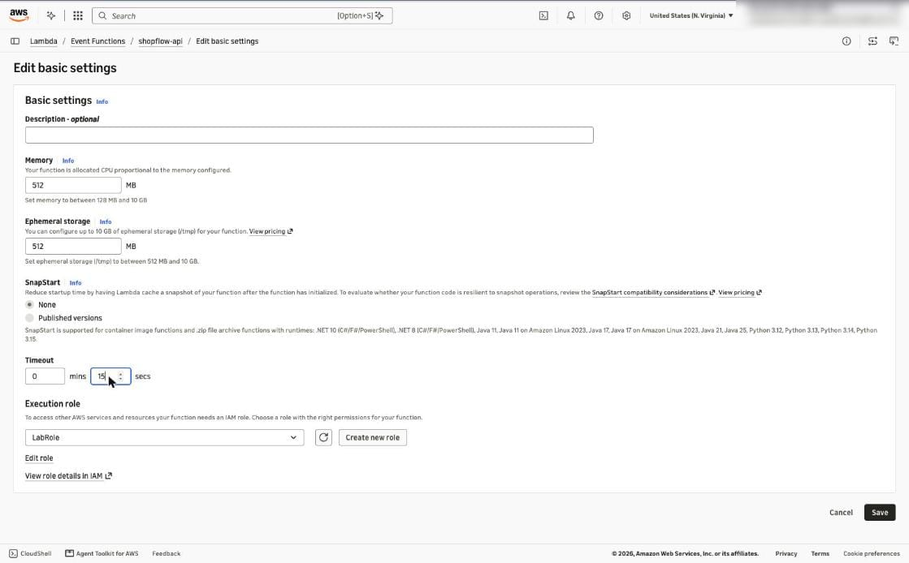

5. **Configuration → Environment variables → Edit** เพิ่ม 5 ค่านี้แล้วกด **Save**

   | Key | Value |
   |---|---|
   | `PRODUCTS_TABLE` | `shopflow-products` |
   | `ORDERS_TABLE` | `shopflow-orders` |
   | `BUCKET` | ชื่อ bucket ของเรา |
   | `TOPIC_ARN` | ARN ของ topic |
   | `LOW_STOCK_THRESHOLD` | `5` |

   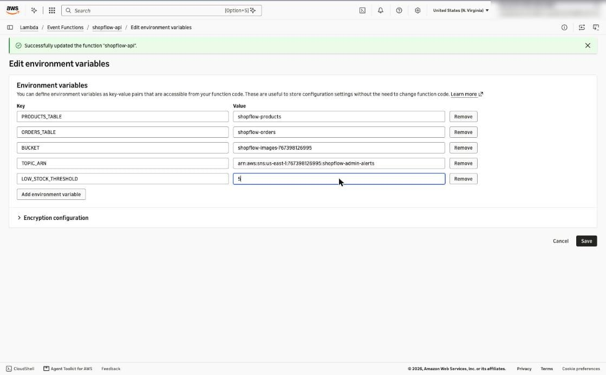

### 5.3 ฟังก์ชันที่เหลือ 4 ตัว (ใช้ CloudShell)

ฟังก์ชันที่เหลือใช้ zip และ environment variable ชุดเดียวกัน ต่างกันแค่ handler การสร้างผ่าน **CloudShell** (ไอคอนเทอร์มินัลมุมซ้ายล่างของ Console) เร็วกว่ากดสร้างทีละตัวอีก 4 รอบ และ CloudShell มีสิทธิ์เท่ากับบัญชี Learner Lab ของเราอยู่แล้ว

```bash
ACCOUNT_ID=$(aws sts get-caller-identity --query Account --output text)
ROLE=arn:aws:iam::$ACCOUNT_ID:role/LabRole
BUCKET=shopflow-images-$ACCOUNT_ID
TOPIC_ARN=arn:aws:sns:us-east-1:$ACCOUNT_ID:shopflow-admin-alerts
RUNTIME=$(aws lambda get-function-configuration --function-name shopflow-api --query Runtime --output text)
curl -s -o code.zip "$(aws lambda get-function --function-name shopflow-api --query Code.Location --output text)"
ENVV="Variables={PRODUCTS_TABLE=shopflow-products,ORDERS_TABLE=shopflow-orders,BUCKET=$BUCKET,TOPIC_ARN=$TOPIC_ARN,LOW_STOCK_THRESHOLD=5}"

for spec in \
  shopflow-on-image-uploaded:src/events/onImageUploaded.handler:1024 \
  shopflow-on-order-created:src/events/onOrderCreated.handler:256 \
  shopflow-daily-report:src/events/dailyReport.handler:256 \
  shopflow-seed:src/seed.handler:512
do
  IFS=: read name handler memory <<< "$spec"
  aws lambda create-function --function-name "$name" --runtime "$RUNTIME" --role "$ROLE" \
    --handler "$handler" --memory-size "$memory" --timeout 60 \
    --zip-file fileb://code.zip --environment "$ENVV" --query '[FunctionName,State]' --output text
done
```

หรือจะสร้างทีละตัวใน Console แบบข้อ 5.2 ก็ได้

| ฟังก์ชัน | Handler | Memory | Timeout |
|---|---|---|---|
| `shopflow-on-image-uploaded` | `src/events/onImageUploaded.handler` | 1024 MB | 60 วินาที |
| `shopflow-on-order-created` | `src/events/onOrderCreated.handler` | 256 MB | 60 วินาที |
| `shopflow-daily-report` | `src/events/dailyReport.handler` | 256 MB | 60 วินาที |
| `shopflow-seed` | `src/seed.handler` | 512 MB | 60 วินาที |

เช็กเร็วๆ ว่า `shopflow-api` อ่าน DynamoDB ได้

```bash
aws lambda invoke --function-name shopflow-api --cli-binary-format raw-in-base64-out \
  --payload '{"httpMethod":"GET","resource":"/products","path":"/products"}' out.json && cat out.json
```

ต้องเห็น `"statusCode":200` และ `"body":"[]"`

## ขั้นที่ 6 · ผูก trigger

### Cognito → `shopflow-presignup`

Cognito → pool ของเรา → **Extensions → Add Lambda trigger** เลือก trigger type **Sign-up** → **Pre sign-up trigger** ฟังก์ชัน `shopflow-presignup` แล้วกด **Add Lambda trigger**

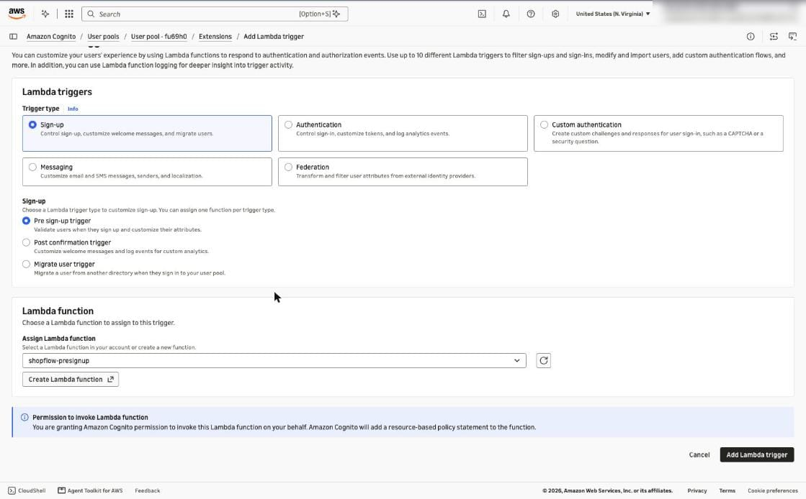

### S3 → `shopflow-on-image-uploaded`

Lambda `shopflow-on-image-uploaded` → **Add trigger** → เลือก source **S3**
- Bucket: bucket รูปของเรา
- Event types: **All object create events**
- Prefix: **`uploads/`** (สำคัญมาก รูปย่อถูกเขียนลง `thumbs/` prefix นี้กันไม่ให้ฟังก์ชันไปสั่งตัวเองซ้ำไม่รู้จบ)
- ติ๊กยอมรับคำเตือนเรื่อง recursive invocation แล้วกด **Add**

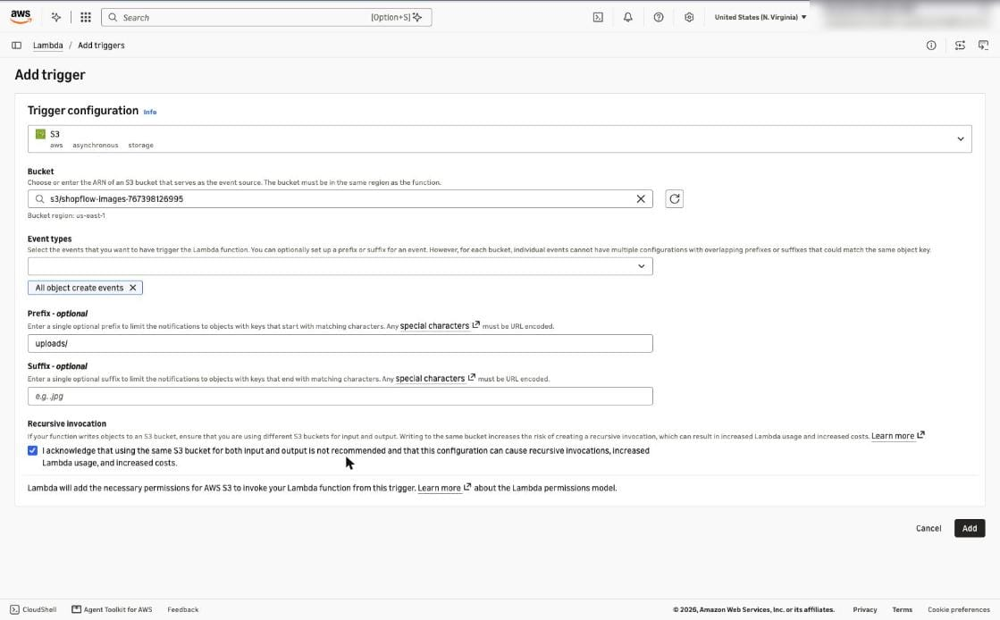

### DynamoDB Stream → `shopflow-on-order-created`

Lambda `shopflow-on-order-created` → **Add trigger** → source **DynamoDB** เลือกตาราง `shopflow-orders`, batch size `10`, starting position **Latest** แล้วกด **Add**

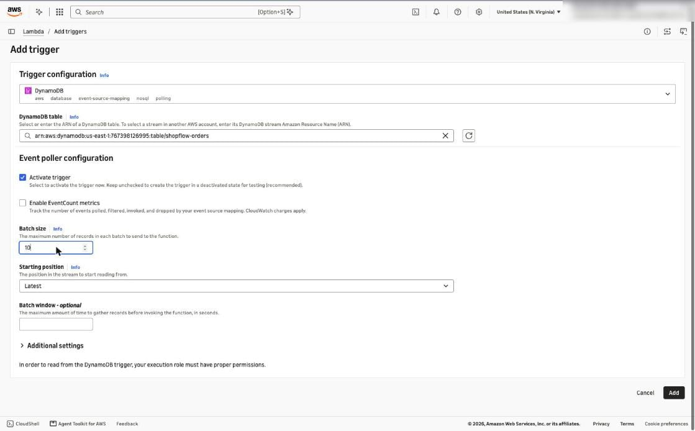

### ใส่สินค้าตัวอย่าง

เมื่อมี trigger ของ S3 แล้ว ให้รันฟังก์ชัน seed หนึ่งครั้งใน CloudShell

```bash
aws lambda invoke --function-name shopflow-seed seed.json && cat seed.json
sleep 15
aws s3 ls s3://shopflow-images-$(aws sts get-caller-identity --query Account --output text)/ --recursive | awk '{print $4}' | cut -d/ -f1 | sort | uniq -c
```

ผลที่ถูกต้องคือ `{"created":10}` ตามด้วย `10 thumbs` และ `10 uploads` ถ้ารันซ้ำตอนที่มีสินค้าอยู่แล้วจะไม่ทำอะไร

## ขั้นที่ 7 · API Gateway

แทนที่จะกดสร้าง 6 resource, 10 method และ CORS ทีละอัน เรา import ไฟล์ OpenAPI ที่เขียนทุกเส้นทาง ตัวตรวจสิทธิ์ Cognito และ CORS ไว้ครบแล้ว

1. สร้างไฟล์ในเครื่องด้วยค่าของเราเอง

   ```bash
   node aws/make-openapi.mjs us-east-1 <account-id> <user-pool-id> aws-build/shopflow-api.openapi.json
   ```

2. **API Gateway → Create API → REST API → Import** กด **Choose file** เลือก `aws-build/shopflow-api.openapi.json` ปล่อย endpoint type เป็น **Regional** แล้วกด **Create API**

   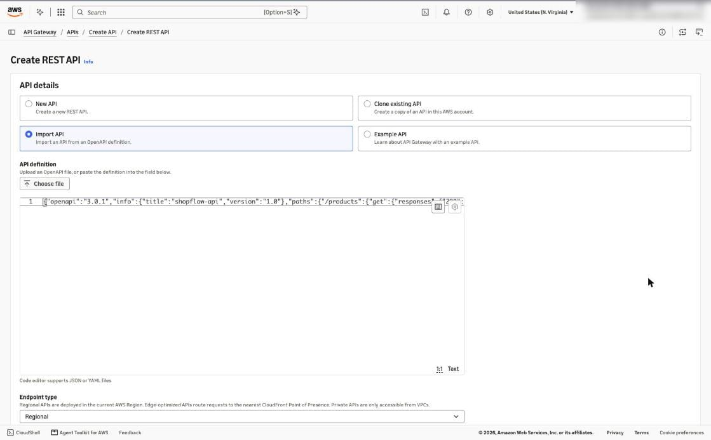

   จะได้ทุกเส้นทางครบ `GET /products` กับ `GET /products/{id}` เปิดให้ทุกคน ที่เหลือต้องล็อกอินผ่าน Cognito

   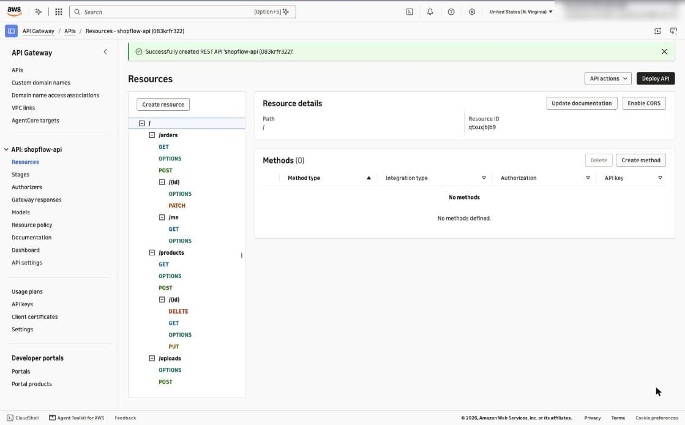

3. อนุญาตให้ API Gateway เรียก Lambda ได้ (ใน CloudShell) ใช้ API ID ที่อยู่ในชื่อหน้า Console (ของเราคือ `083krfr322`)

   ```bash
   ACCOUNT_ID=$(aws sts get-caller-identity --query Account --output text)
   API_ID=<your api id>
   aws lambda add-permission --function-name shopflow-api --statement-id apigateway-invoke \
     --action lambda:InvokeFunction --principal apigateway.amazonaws.com \
     --source-arn "arn:aws:execute-api:us-east-1:$ACCOUNT_ID:$API_ID/*"
   ```

4. กด **Deploy API** เลือก stage **New stage** ตั้งชื่อ `prod` แล้วกด **Deploy**

   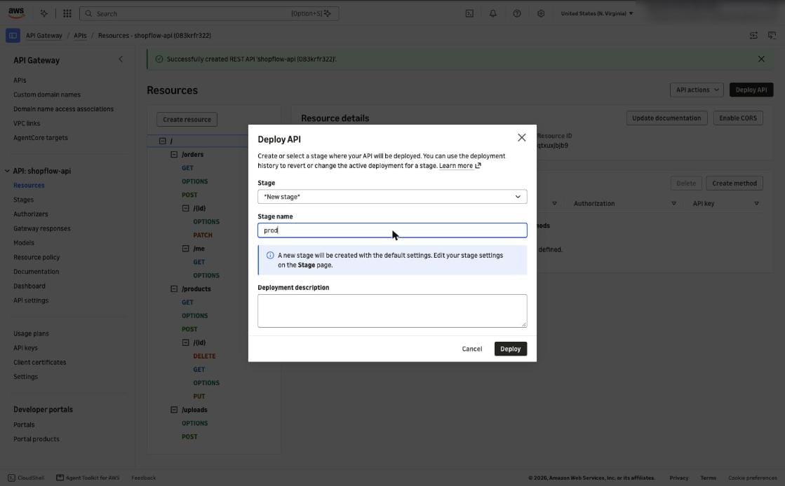

5. คัดลอก **Invoke URL** จากหน้า stage

   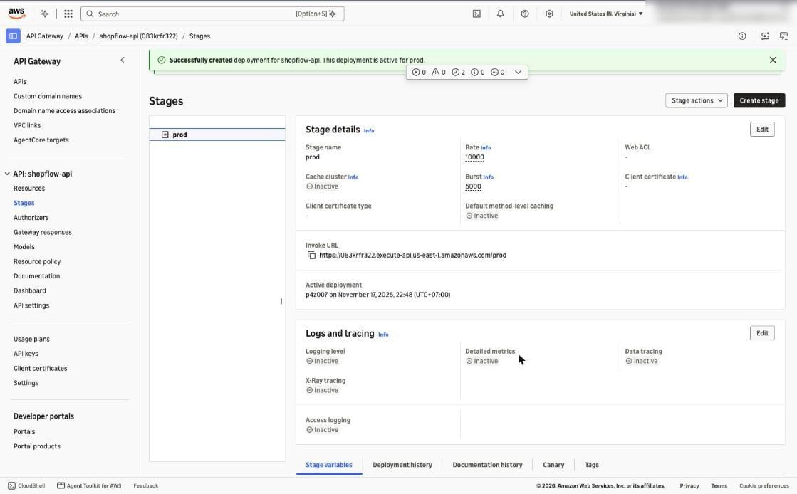

6. ทดสอบ

   ```bash
   curl https://<api-id>.execute-api.us-east-1.amazonaws.com/prod/products
   curl https://<api-id>.execute-api.us-east-1.amazonaws.com/prod/orders
   ```

   คำสั่งแรกต้องได้สินค้า 10 รายการ คำสั่งที่สองต้องได้ `{"message":"Unauthorized"}` แปลว่าตัวตรวจสิทธิ์ทำงาน

## ขั้นที่ 8 · ตั้งเวลารายงานประจำวัน

1. **Amazon EventBridge → Scheduler → Schedules → Create schedule** ตั้งชื่อ `shopflow-daily-report`
2. เลือก **Recurring schedule**, time zone **Asia/Bangkok**, **Cron-based**, cron `0 8 * * ? *`, flexible time window **Off** แล้วกด **Next**

   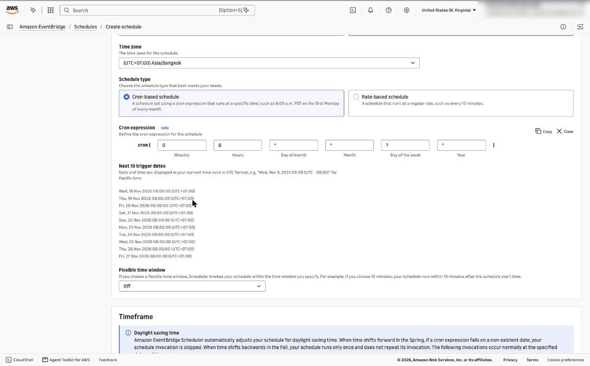

3. Target เลือก **AWS Lambda Invoke** ฟังก์ชัน `shopflow-daily-report` แล้วกด **Next**

   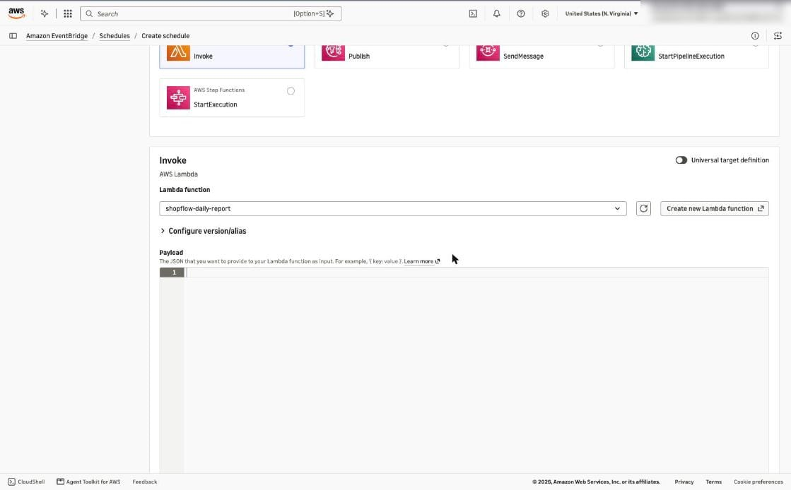

4. Permissions เลือก **Use existing role** → **`LabRole`** แล้วกด **Next → Create schedule**

   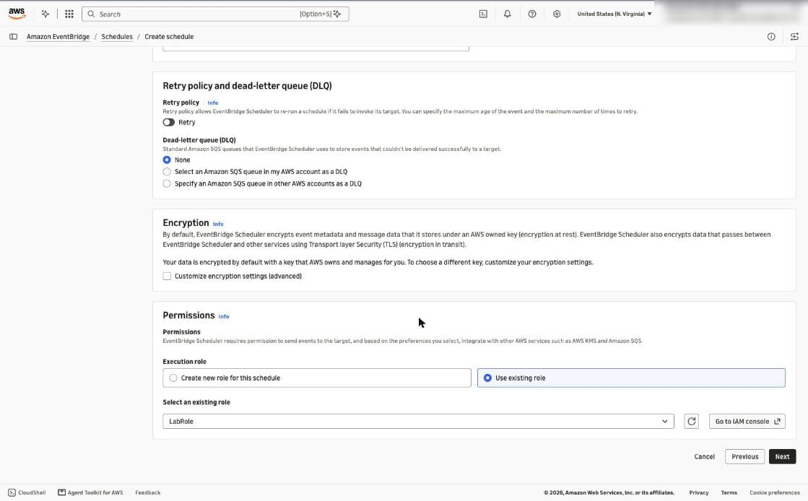

ถ้าอยากได้รายงานทันที: `aws lambda invoke --function-name shopflow-daily-report r.json && cat r.json`

## ขั้นที่ 9 · หน้าเว็บบน Amplify Hosting

1. build หน้าเว็บด้วยค่าทั้ง 3 ของเรา

   ```bash
   ./aws/build-web.sh <invoke-url> <user-pool-id> <app-client-id>
   ```

   จะได้ไฟล์ `aws-build/shopflow-web.zip` ที่มี `index.html` อยู่ชั้นบนสุดของ zip

2. **AWS Amplify → Deploy an app → Deploy without Git → Next**

   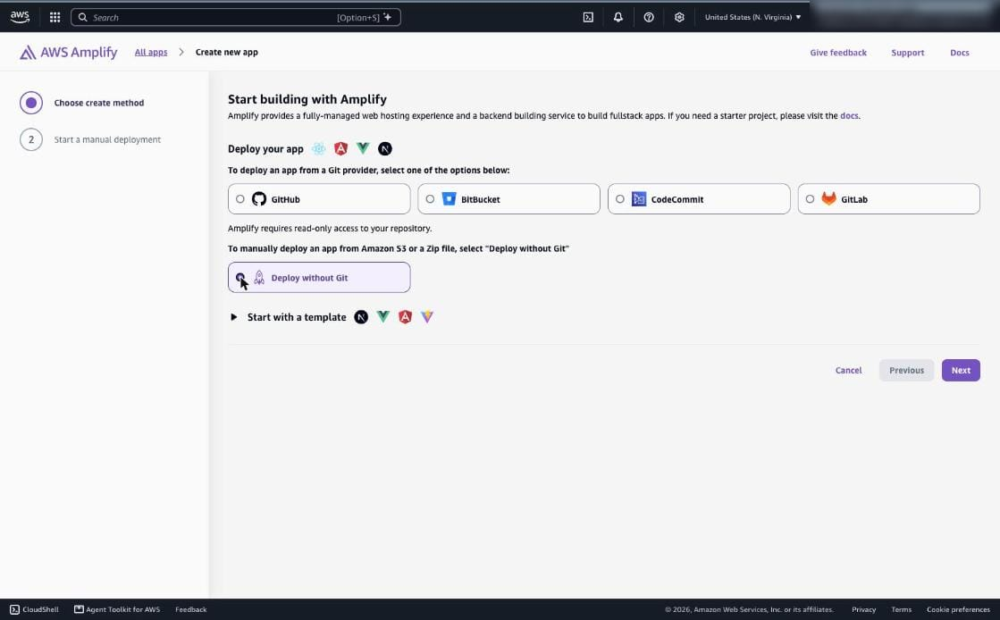

3. App name `shopflow`, branch name `main`, method **Drag and drop** เลือก `aws-build/shopflow-web.zip` แล้วกด **Save and deploy**

   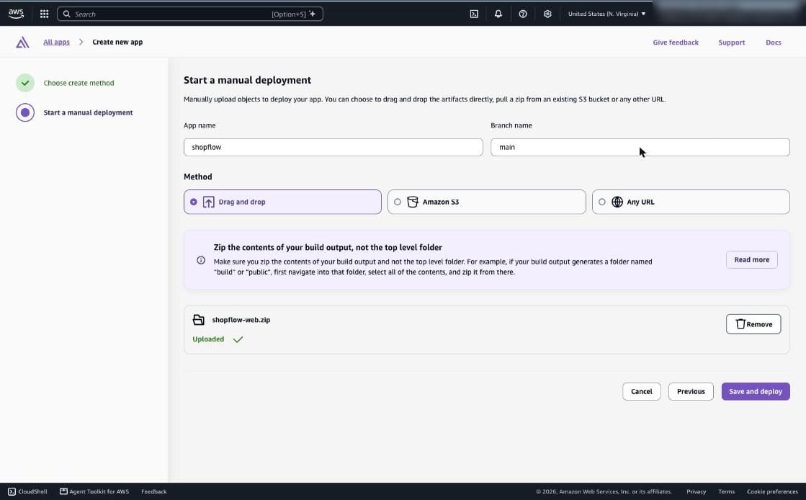

4. เพิ่มกฎ rewrite สำหรับเว็บหน้าเดียว ให้ลิงก์อย่าง `/shop` หรือ `/admin` ไม่ 404 ตอนรีเฟรช รันใน CloudShell โดยใช้ app ID จากหน้า Amplify

   ```bash
   aws amplify update-app --app-id <app-id> --custom-rules '[{"source":"</^[^.]+$|\\.(?!(css|gif|ico|jpg|js|png|txt|svg|woff|woff2|ttf|map|json|webp)$)([^.]+$)/>","target":"/index.html","status":"200"}]'
   ```

   (ทำใน Console ก็ได้: **Hosting → Rewrites and redirects → Manage redirects** ใส่ source ตามข้างบน target `/index.html` type **200 (Rewrite)**)

5. **Domain** ในหน้าแอปคือที่อยู่ร้านของเรา เช่น `https://main.d2yz42dazxw1qn.amplifyapp.com`

   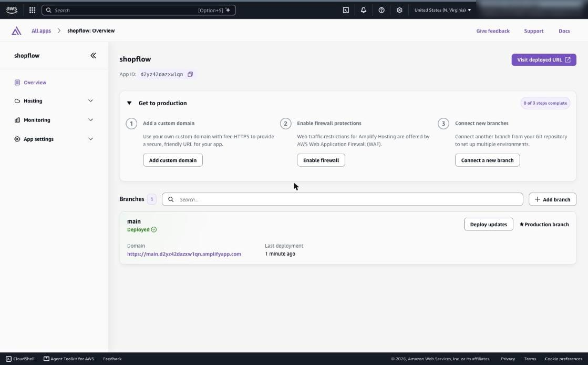

## ขั้นที่ 10 · ทดสอบทั้งระบบ

สร้างแอดมินคนแรก

1. เปิดหน้าร้าน กด **เข้าสู่ระบบ → สมัครสมาชิก** แล้วสมัครด้วยอีเมลแอดมิน
2. Cognito → pool ของเรา → **Users** → เลือกผู้ใช้นั้น → **Add user to group** → `admin`
3. ออกจากระบบแล้วเข้าใหม่ เมนูจะมี **หลังร้าน** ขึ้นมา

เช็กลิสต์

- [ ] หน้าร้านแสดงสินค้า 10 รายการพร้อมรูป
- [ ] รีเฟรชหน้า `/shop` แล้วไม่เจอ 404
- [ ] ลูกค้าใหม่สมัครแล้วเข้าสู่ระบบได้ทันที
- [ ] สั่งซื้อด้วยบัตร `4242 4242 4242 4242` สำเร็จ และบัตร `4000 0000 0000 0002` ถูกปฏิเสธ
- [ ] คำสั่งซื้อขึ้นในหน้า **คำสั่งซื้อของฉัน** และในตาราง `shopflow-orders`
- [ ] สต็อกของสินค้าที่สั่งลดลงในตาราง `shopflow-products`
- [ ] อีเมลแอดมินได้รับ "ออร์เดอร์ใหม่ …"
- [ ] แอดมินเปลี่ยนสถานะคำสั่งซื้อได้ และลูกค้าเห็นสถานะใหม่
- [ ] แอดมินเพิ่มสินค้าพร้อมรูปได้ และมีรูปย่อขึ้นใน `thumbs/` ภายในไม่กี่วินาที
- [ ] สั่งรัน `shopflow-daily-report` แล้วได้อีเมลรายงาน

## อัปเดตแอปภายหลัง

| แก้อะไร | ทำอย่างไร |
|---|---|
| โค้ด backend (`backend/src`) | รัน `./aws/build-lambda.sh` แล้วอัปโหลด `aws-build/shopflow-backend.zip` ให้ทุก Lambda (หรือใน CloudShell อัปไฟล์ผ่าน **Actions → Upload file** แล้วรัน `aws lambda update-function-code --function-name <name> --zip-file fileb://shopflow-backend.zip`) |
| หน้าเว็บ (`frontend/src`) | รัน `./aws/build-web.sh …` ใหม่ แล้วไปที่ Amplify → แอป → **Deploy updates** แล้ววาง zip ใหม่ |
| เส้นทาง API | แก้ `aws/make-openapi.mjs` แล้วสร้างไฟล์ใหม่ ไปที่ API Gateway → **API actions → Import API** (แบบ overwrite) แล้วกด **Deploy API** ไปที่ `prod` |

## ปัญหาที่เจอบ่อย

| อาการ | สาเหตุ | วิธีแก้ |
|---|---|---|
| `Runtime.ImportModuleError: Cannot find module 'index'` | handler ยังเป็น `index.handler` | ตั้ง handler ตามตารางด้านบน |
| ไม่มีรูปย่อเลย และ log ขึ้น `Could not load the sharp module` | zip ไม่มี `sharp` รุ่น Linux | สร้าง zip ด้วย `./aws/build-lambda.sh` อย่า zip โฟลเดอร์ `backend/` เอง |
| หน้าหลังร้านขึ้น `Unauthorized` | token หมดอายุ (1 ชั่วโมง) หรือผู้ใช้ไม่ได้อยู่กลุ่ม `admin` | ออกจากระบบแล้วเข้าใหม่ และเช็กกลุ่ม |
| สมัครแล้วขึ้นว่ารหัสผ่านไม่ตรงนโยบาย | ยังใช้นโยบายรหัสผ่านค่าเริ่มต้นของ Cognito | ขั้นที่ 4 ข้อ 3 |
| สมัครได้แต่ล็อกอินแล้วขึ้น `User is not confirmed` | ยังไม่ได้ผูก trigger Pre sign-up | ทำขั้นที่ 6 แล้วกดยืนยันผู้ใช้คนนั้นใน Cognito → Users |
| เบราว์เซอร์บล็อกการอัปรูป (CORS) | bucket ยังไม่ได้ตั้ง CORS | ขั้นที่ 2 ข้อ 3 |
| รีเฟรช `/shop` แล้วเจอ 404 | ยังไม่ได้ใส่กฎ rewrite | ขั้นที่ 9 ข้อ 4 |
| ไม่มีอีเมลมาเลย | ยังไม่ได้ยืนยัน subscription | ขั้นที่ 3 ข้อ 4 |
| บันทึกคำสั่งซื้อได้แต่สต็อกไม่ลด | ยังไม่เปิด stream หรือยังไม่ผูก trigger | ขั้นที่ 1 ข้อ 5 และขั้นที่ 6 แล้วดู log ของ `shopflow-on-order-created` |

ดู log ของ Lambda ทุกตัวได้ที่ Lambda → ฟังก์ชัน → **Monitor → View CloudWatch logs**

## ลบทิ้งเมื่อเลิกใช้

ลบตามลำดับนี้เมื่อจบโปรเจกต์: แอป Amplify → schedule → API → Lambda ทั้ง 6 ตัว → ล้างแล้วลบ S3 bucket → ตาราง DynamoDB ทั้ง 2 ตาราง → Cognito user pool (ปิด deletion protection ก่อน) → SNS topic
